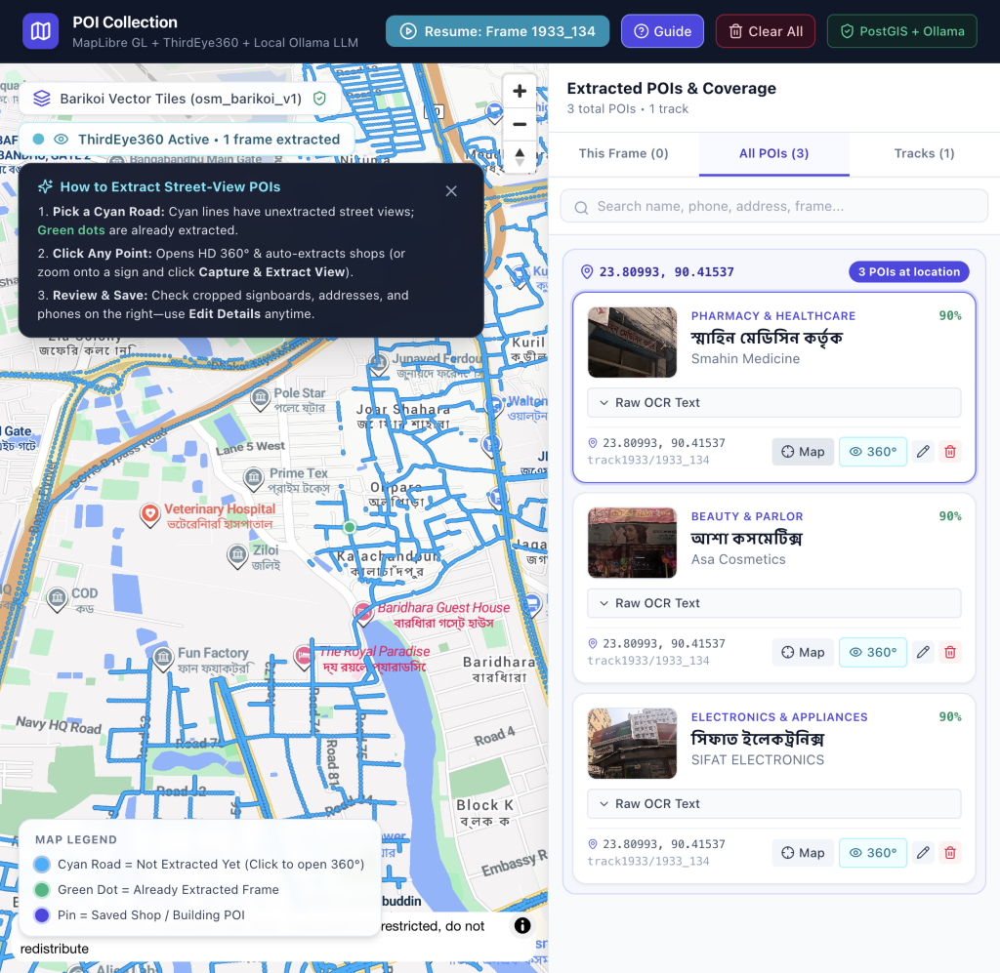

# POI Collection

An interactive **Street View POI Extraction & Map Dashboard** built with **Next.js 14**, **MapLibre GL**, **Three.js**, **NestJS**, **PostGIS**, and **Ollama (`qwen3-vl:8b-instruct`)**. It lets operators browse ThirdEye360 street-view tracks in Bangladesh, inspect 360° panoramas, and automatically detect, crop, and extract Bengali/English business signboards into a spatial database.

---

## UI Preview



---

## Architecture

| Service | Container | Port | Stack |
| :--- | :--- | :--- | :--- |
| **Web Dashboard** | `poi_collection_web` | `3000` | Next.js 14, Tailwind CSS, MapLibre GL, Three.js |
| **Extraction API** | `poi_collection_api` | `4000` | NestJS 10, Sharp (equirectangular-to-perspective projection) |
| **Spatial Database** | `poi_collection_db` | `5432` | PostgreSQL 16 + PostGIS 3.4 (database: `poi_collection`) |
| **Vision LLM** | Host Ollama (or Gemini) | `11434` | `qwen3-vl:8b-instruct` (local/offline) or optional `gemini-2.5-flash` |

### Two-Stage Extraction Pipeline
1. **Stage 1 (Signboard Grounding):** Projects a `1288×840` perspective view from the full-resolution 8K street-view panorama at the viewer's `yaw`, `pitch`, and `fov`, then detects signboard bounding boxes (`bbox_2d`).
2. **Stage 2 (Focused OCR):** Projects high-resolution signboard crops from the 8K panorama, saves them to `data/crops/`, extracts Bengali & English business names, category, proprietor, address, and phone numbers, and stores the POI in PostGIS.

---

## Prerequisites

- **Docker Desktop** (or Docker Engine + Compose v2)
- **Ollama** installed and running on your host (`http://localhost:11434`)
- Pull the default vision model (~6.2 GB):
  ```bash
  ollama pull qwen3-vl:8b-instruct
  ```
- *(Optional)* **Node.js 20+** if running the frontend/backend directly outside Docker.

---

## Quick Start (Docker Compose)

1. **Ensure Ollama is running** on your host machine (`ollama serve` or the macOS Ollama menu bar app).
2. **Build and start all services:**
   ```bash
   docker compose up -d --build
   ```
3. **Verify all containers are healthy:**
   ```bash
   docker compose ps
   ```
   You should see `poi_collection_db`, `poi_collection_api`, and `poi_collection_web` with status `(healthy)`.
4. **Open the application:**
   - Dashboard UI: [http://localhost:3000](http://localhost:3000)
   - Backend API: [http://localhost:4000/api/pois](http://localhost:4000/api/pois)

To stop the stack:
```bash
docker compose down
```

---

## Usage Workflow

1. Open [http://localhost:3000](http://localhost:3000).
2. Click any cyan **ThirdEye360** street-view point on the map to open the **HD 360° Panorama Viewer**.
3. Rotate/zoom toward storefronts and click **Capture & Extract View** (or toggle **Auto-Extract: ON**).
4. Extracted POIs appear immediately on the map (green coverage pins) and in the right-hand sidebar (`This Frame` / `All POIs` / `Tracks`), complete with clickable crop thumbnails, lightbox zoom, inline editing, and `Clear All Data`.

---

## Configuration

Copy `.env.example` to `.env.local` for local Next.js development, or pass environment variables to `docker compose`:

| Variable | Default | Description |
| :--- | :--- | :--- |
| `OLLAMA_MODEL` | `qwen3-vl:8b-instruct` | Local Ollama vision model |
| `OLLAMA_BASE_URL` | `http://host.docker.internal:11434` | Ollama endpoint from inside Docker |
| `GEMINI_API_KEY` | *(empty)* | Optional Google AI Studio free-tier key; falls back to Ollama if unset or rate-limited |
| `GEMINI_MODEL` | `gemini-2.5-flash` | Gemini model when `GEMINI_API_KEY` is set |
| `POSTGRES_USER` | `barikoi` | PostgreSQL user |
| `POSTGRES_PASSWORD` | `barikoi_secret` | PostgreSQL password |
| `POSTGRES_DB` | `poi_collection` | PostgreSQL database name |
| `NEXT_PUBLIC_API_BASE_URL` | `http://localhost:4000` | Backend API URL for the browser |
| `NEXT_PUBLIC_BARIKOI_API_KEY` | *(configured in compose)* | Barikoi Maps API key |

### Optional: Enable Gemini 2.5 Flash Free Tier
```bash
GEMINI_API_KEY=your_aistudio_key docker compose up -d api
```
If `GEMINI_API_KEY` is unset, extraction runs 100% locally and offline on Ollama (`qwen3-vl:8b-instruct`).

---

## Local Development (Without Docker for App)

1. **Start only PostGIS:**
   ```bash
   docker compose up -d db
   ```
2. **Run the NestJS backend (`http://localhost:4000`):**
   ```bash
   cd backend
   npm install
   npm run start:dev
   ```
3. **Run the Next.js frontend (`http://localhost:3000`):**
   ```bash
   cp .env.example .env.local
   npm install
   npm run dev
   ```

---

## API Endpoints

- `GET /api/pois` — List all persisted POIs
- `POST /api/pois` — Create a POI record manually
- `POST /api/pois/extract` — Run 2-stage 8K panorama extraction (`frameId`, `latitude`, `longitude`, `yaw`, `pitch`, `fov`, `imageUrlHigh`)
- `PATCH /api/pois/:id` — Update POI details
- `DELETE /api/pois/:id` — Delete a single POI and its crop
- `DELETE /api/pois` — Clear all POIs and crop images
- `GET /api/crops/:filename` — Serve cropped signboard JPEG images from `data/crops/`
